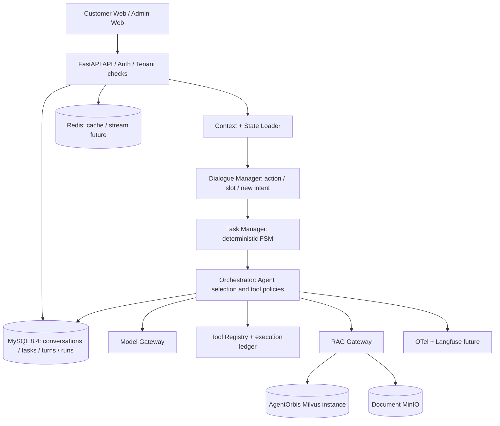

# Architecture

## Responsibility boundaries

- `api`: HTTP validation and authenticated identity; no business routing heuristics.
- `domain`: typed state and deterministic state transition functions, unit-testable offline.
- `application`: use-case transaction orchestration, concurrency/idempotency.
- `infrastructure`: MySQL repositories, Milvus adapter, Redis, model provider, tool HTTP clients.
- `agents`: future bounded Agent Loop, prompt renderer, model/agent adapters (no business DB writes inside prompt code).
- `evals`: offline action/slot fixtures and online full workflow tests.

## Persistence contract

- MySQL: tenant/user/conversation relationships; messages; turns with unique `request_id`; JSON State with version; task audit entries.
- Redis: later sessions cache, stream replay, short-lived locks. Do not store the *only copy* of task state in Redis.
- Milvus: chunks and embeddings only; source document metadata in MySQL, originals in MinIO.
- Compose provides isolated infrastructure for Milvus and document storage;
  RAG indexing/retrieval and file upload use cases are not implemented yet.
- Streaming SSE: separate *durable business events* from *ephemeral model token chunks*; implement persisted stream cursor before claiming reconnect replay.

## Future run lifecycle (not implemented in starter)

1. Acquire per-conversation execution lease; append user turn with idempotency key.
2. Read State and relevant messages; interpret action, preferably deterministically for known expected slots.
3. Release short DB transaction before slow LLM/tool I/O.
4. Execute allowed tools with audited IDs and idempotency keys; side effect operations only after explicit approval.
5. Commit new State with version / lease validation, append events and final reply.
6. On timeout or uncertain external result, reconcile provider-side status rather than blindly retry side effects.

## RAG pipeline (phase 2)

Upload -> virus/type/size validation -> object storage -> parse/OCR if needed -> chunk + source provenance -> embeddings -> Milvus index -> hybrid retrieval -> metadata ACL filter -> rerank -> trusted evidence -> citations. Ensure tenant filters are server-supplied and never inferred from user prompt.
