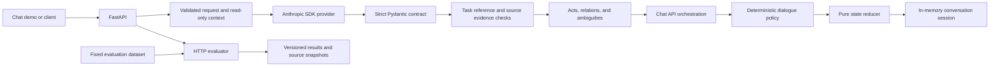

# Architecture

Business intents use the canonical IDs in [taxonomy v1](INTENT_TAXONOMY.md). The registry defines legacy aliases, task-type mappings, required slots, and capability requirements. Interpretation results include `taxonomy_version: "1.0"`; policy maps business goals to stable task state types.

**Languages:** English | [简体中文](zh/ARCHITECTURE.md)

The first module is a read-only message interpreter. It returns a structured understanding that a later policy layer can review before changing task state.

The interpreter does not own conversations, create tasks, answer customers, or execute tools. The API validates request bounds; the model proposes semantic acts; server-side validation rejects malformed structures, unsupported task references, and entities without literal evidence in the current message.

`MessageUnderstanding` is an interpretation result, not an authorization decision. The chat API passes it to a deterministic dialogue policy and pure state reducer, then stores the resulting state and domain events in a development-only in-memory session. MySQL persistence and external tools follow after the state behavior is evaluated.

Everything currently needed for the first module runs in Docker: one API container, plus an optional test profile. The model key remains local in `.env`. Evaluation datasets and immutable run records live in the repository-level [`evaluation/`](../evaluation/README.md) folder.
