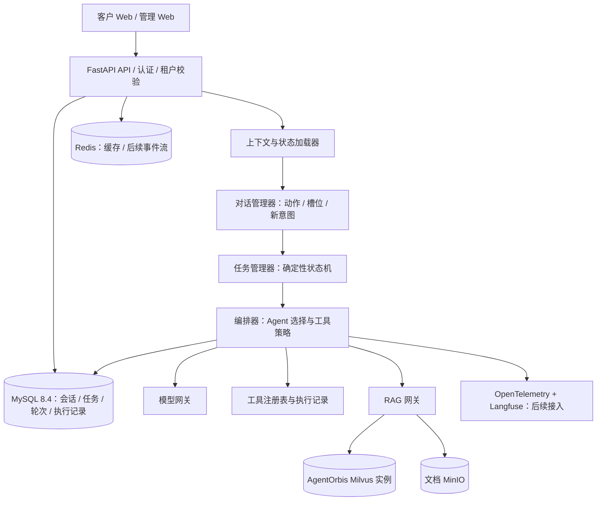

# 系统架构

**语言：**[English](../ARCHITECTURE.md) | 简体中文

## 职责边界

- `api`：HTTP 参数校验和已认证身份处理；不承载业务路由启发式规则。
- `domain`：类型化状态和确定性的状态转换函数，可离线单元测试。
- `application`：用例编排、事务管理、并发和幂等控制。
- `infrastructure`：MySQL 仓储、Milvus 适配器、Redis、模型供应商和工具 HTTP 客户端。
- `agents`：后续实现受控 Agent Loop、提示词渲染及模型/Agent 适配器；提示词代码不直接写业务数据库。
- `evals`：离线动作/槽位样例和在线完整流程测试。

## 持久化约定

- MySQL：保存租户、用户、会话关系，消息、带唯一 `request_id` 的轮次、含版本号的 JSON 状态和任务审计记录。
- Redis：后续用于会话缓存、事件流重放和短时锁。任务状态不能只保存在 Redis 中。
- Milvus：只保存文本块和向量；源文档元数据保存在 MySQL，原文件保存在 MinIO。
- Compose 提供隔离的 Milvus 和文档存储基础设施；RAG 索引/检索和文件上传用例尚未实现。
- SSE 流式响应应区分持久化的业务事件和临时模型 Token；在承诺断线重连重放前，先实现持久化事件游标。

## 后续执行流程（当前版本尚未实现）

1. 获取会话级执行租约，并通过幂等键写入用户轮次。
2. 读取状态和相关消息；理解动作时，已知待填槽位优先采用确定性逻辑。
3. 在执行耗时的 LLM 或工具 I/O 之前，结束短时数据库事务。
4. 使用可审计 ID 和幂等键执行获准的工具；产生副作用的操作仅在明确批准后执行。
5. 校验状态版本或租约后提交新状态，追加事件和最终回复。
6. 超时或外部结果不确定时，先查询供应商侧状态进行核对，不盲目重试副作用操作。

## RAG 流程（第二阶段规划）

文件上传 → 病毒/类型/大小校验 → 对象存储 → 解析或 OCR → 分块并保留来源 → 向量化 → Milvus 索引 → 混合检索 → 元数据 ACL 过滤 → 重排 → 可信证据与引用。租户过滤条件必须由服务端提供，不能从用户提示词中推断。
