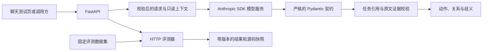

# 系统架构

**语言：**[English](../ARCHITECTURE.md) | 简体中文

第一个模块是只读消息解释器。它输出结构化语义结果，供后续策略层审查后再决定是否改变任务状态。

解释器不持有会话、不创建任务、不代替客服回复，也不执行工具。API 限制请求范围；模型提出语义动作；服务端再拒绝格式错误、引用未知任务或缺乏当前消息原文依据的实体。

`MessageUnderstanding` 表示解释结果，不代表授权或执行决策。下一阶段计划增加确定性的对话策略、明确的澄清决策和纯状态归约器，再沿此边界接入持久化与外部工具。

首个模块所需环境均通过 Docker 运行：一个 API 容器，以及按需启动的测试容器。模型密钥保存在本地 `.env`。评测数据集和不可变的运行记录统一放在仓库根目录的 [`evaluation/`](../../evaluation/README.md)。
